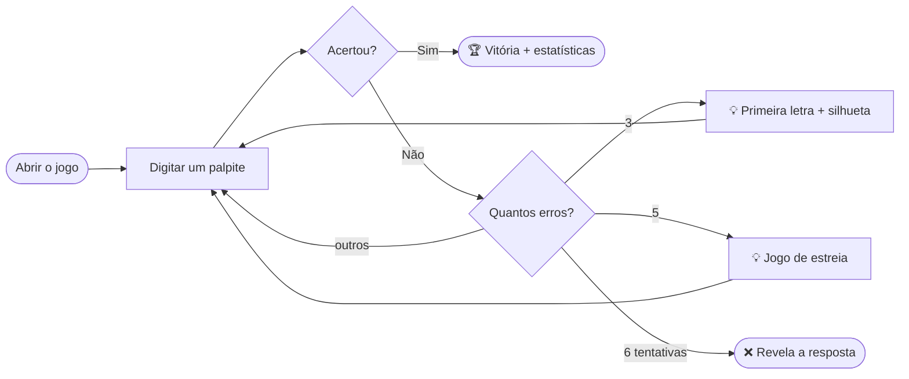
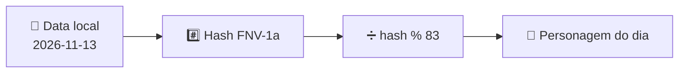

<div align="center">


<br>

[](https://pedr0sarri.github.io/MarioTermo/)


</div>

---

## 🎮 Sobre

**MarioTermo** é um jogo web de adivinhação diária, no estilo Wordle, com personagens do universo Mario. Todo dia um personagem é sorteado e você tem **6 tentativas** para descobrir qual é. Cada palpite mostra o quanto ele se parece com a resposta.

Todos os jogadores recebem o mesmo personagem no mesmo dia, sem servidor e sem banco de dados.

### ✨ Funcionalidades

- 📅 **Personagem do dia**, igual para todos e trocado à meia-noite
- 🧩 **83 personagens** de Super Mario, Donkey Kong, Yoshi, Wario, Luigi's Mansion, Paper Mario e Mario & Luigi
- 🔎 **Autocompletar** que ignora acentos e pontuação
- 💡 **Dicas progressivas**: primeira letra e silhueta após 3 erros, jogo de estreia após 5
- 📊 **Estatísticas**: jogos, % de vitórias, sequência e recorde
- 📤 **Compartilhar** o resultado em emojis pelo menu nativo do celular
- 💾 **Progresso salvo**: recarregar a página não perde os palpites
- 📱 **Feito para celular**: layout em cartões, campo fixo no topo e áreas de toque grandes

## 🕹️ Como jogar

| Cor | Significado |
|:--:|:--|
| 🟩 | Igual ao personagem do dia |
| 🟨 | Ano de estreia com diferença de até 3 anos |
| ⬛ | Diferente |
| ↑ ↓ | A resposta é mais nova / mais antiga |

Exemplo de palpite (`Bowser`), com resposta `Donkey Kong`:

```
🧬 Koopa   🎭 Vilão   📚 Super Mario   🕹️ NES    📆 1985 ↓   🏎️ Jogável
   ⬛         ⬛           ⬛              ⬛         ⬛           🟩
```

Digite o nome de um personagem e toque em uma das sugestões. Cada palpite é comparado com o personagem do dia em 6 atributos:

| Pista | O que compara | Exemplo |
|:--|:--|:--|
| 🧬 **Espécie** | A espécie do personagem | Humano, Koopa, Toad, Kong |
| 🎭 **Papel** | A função na história | Herói, Aliado, Vilão, Inimigo |
| 📚 **Série** | A franquia de origem | Super Mario, Donkey Kong, Wario |
| 🕹️ **Plataforma** | O console do jogo de estreia | Arcade, NES, SNES, Switch |
| 📆 **Ano** | O ano de estreia, com ↑ ↓ | 1981 ↑ |
| 🏎️ **MK8 Deluxe** | Se é jogável no Mario Kart 8 Deluxe | Jogável / Não jogável |

### Fluxo de uma partida



## ⚙️ Como funciona o sorteio

O personagem do dia sai de um **hash da data**. Como a mesma data sempre gera o mesmo número, todos os jogadores veem o mesmo personagem sem precisar de backend.



```js
function dailyIndex(key) {        // key = "AAAA-MM-DD"
  let h = 0x811c9dc5;             // FNV-1a
  for (const c of key) { h ^= c.charCodeAt(0); h = Math.imul(h, 0x01000193); }
  return (h >>> 0) % CHARS.length;
}
```

Os palpites do dia e as estatísticas ficam no `localStorage` do navegador. Cada dia entra nas estatísticas uma única vez, mesmo se a página for recarregada.

## 📁 Estrutura

```
MarioTermo/
├── index.html      # jogo completo: HTML, CSS e JavaScript
├── img/            # (opcional) imagens para a silhueta
└── README.md
```

## 🚀 Como rodar

Não precisa instalar nada.

```bash
git clone https://github.com/Pedr0Sarri/MarioTermo.git
cd MarioTermo
# abra o index.html no navegador
```

Para publicar, ative o **GitHub Pages** em *Settings → Pages* com a branch `main` e a pasta `/ (root)`.

## 🖼️ Silhuetas (opcional)

O jogo mostra a silhueta do personagem após 3 erros, se houver uma imagem dele em `img/`. Sem a imagem, ele funciona normalmente, só com texto.

O nome do arquivo é o nome do personagem em minúsculas, com hífen no lugar de espaços e pontuação. Use PNG com fundo transparente.

| Personagem | Arquivo |
|:--|:--|
| Mario | `img/mario.png` |
| Bowser Jr. | `img/bowser-jr.png` |
| Professor E. Gadd | `img/professor-e-gadd.png` |

## 🗺️ Próximos passos

- [ ] Modo infinito (sem limite diário)
- [ ] Filtro por série
- [ ] Mais personagens
- [ ] Tema claro

## ⚖️ Aviso legal

Projeto de fã, sem fins comerciais, feito para estudo. **Mario** e todos os personagens citados são marcas registradas da **Nintendo**. Este projeto não é afiliado à Nintendo nem endossado por ela.

<div align="center">
<br>
Feito por <a href="https://github.com/Pedr0Sarri">Pedro Sarri</a> · Veja também o <a href="https://github.com/Pedr0Sarri/PokeTermo">PokeTermo</a>
</div>


